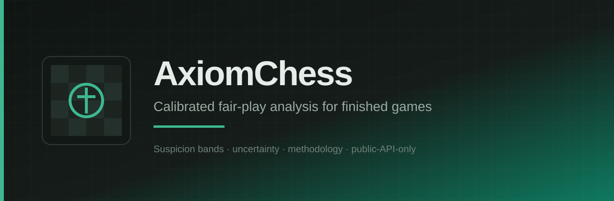

<p align="center">
  
</p>

# docs

Product wiki and GitHub Pages site for AxiomChess.

Language: English only. No emoji.

## Site

| Item | Value |
| --- | --- |
| Source folder | `site/` |
| Regenerator | `node scripts/build-wiki-pages.mjs` |
| Pages workflow | `.github/workflows/pages.yml` |
| Published URL | https://axiomchess.github.io/docs/ |
| Visual system | Ink and Felt wiki shell (Syne + IBM Plex) |

Pages is configured with `build_type=workflow`. Pushing to `main` deploys `site/`.

## Wiki map

| Path | Content |
| --- | --- |
| `site/index.html` | Wiki home |
| `site/getting-started.html` | Web + API quick start |
| `site/limits.html` | Non-goals and claim limits |
| `site/ethics.html` | Public-API-only ethics |
| `site/privacy.html` | Retention and erasure |
| `site/methodology.html` | engine-v1 / calibration-v1 |
| `site/scoring-bands.html` | Band cut points |
| `site/architecture.html` | Multi-repo architecture |
| `site/api-overview.html` | `/v1` routes |
| `site/api-quotas.html` | Auth, quotas, cache |
| `site/supported-sites.html` | Lichess + Chess.com |
| `site/self-host.html` | Operator setup |
| `site/glossary.html` | Terms |
| `site/styles.css` | Wiki styling |
| `site/banner.svg` / `site/mark.svg` | Brand graphics |

Edit page bodies in `scripts/build-wiki-pages.mjs`, then regenerate.

## Local check

```bash
node scripts/build-wiki-pages.mjs
# CI job docs-skeleton verifies required wiki files and banned phrases
```

## License

MIT. See `LICENSE`.
